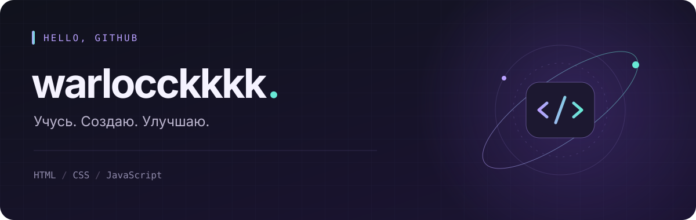

  

  <a href="#обо-мне">Обо мне</a> &nbsp;·&nbsp;
  <a href="#в-работе">В работе</a> &nbsp;·&nbsp;
  <a href="https://github.com/warlocckkkk?tab=repositories">Репозитории ↗</a>

 

### Обо мне

Привет, я **warlocckkkk** 👋

Изучаю веб-разработку через практику: превращаю идеи в небольшие проекты и шаг за шагом добавляю им новые возможности. Сейчас развиваю браузерную игру **CheburJump**.

  <code>HTML5</code> &nbsp; <code>CSS3</code> &nbsp; <code>JavaScript</code>

 

### В работе

<table>
  <tr>
    <td>
      <h3>🍊 <a href="https://github.com/warlocckkkk/CheburJump">CheburJump</a></h3>
      
<strong>Чебурашка: мандариновый забег</strong>

      
Браузерная аркада: перепрыгивай мандарины, собирай бонусы и побей собственный рекорд.

      
Физика прыжка · столкновения · три жизни · сохранение рекорда

      
<code>HTML</code> <code>CSS</code> <code>Vanilla JavaScript</code>

      
<a href="https://github.com/warlocckkkk/CheburJump">Смотреть код ↗</a> &nbsp;·&nbsp; <a href="https://github.com/warlocckkkk/CheburJump/blob/main/ROADMAP.md">План развития ↗</a>

    </td>
  </tr>
</table>

 

  От первой идеи — к работающему проекту. По одному коммиту за раз.

